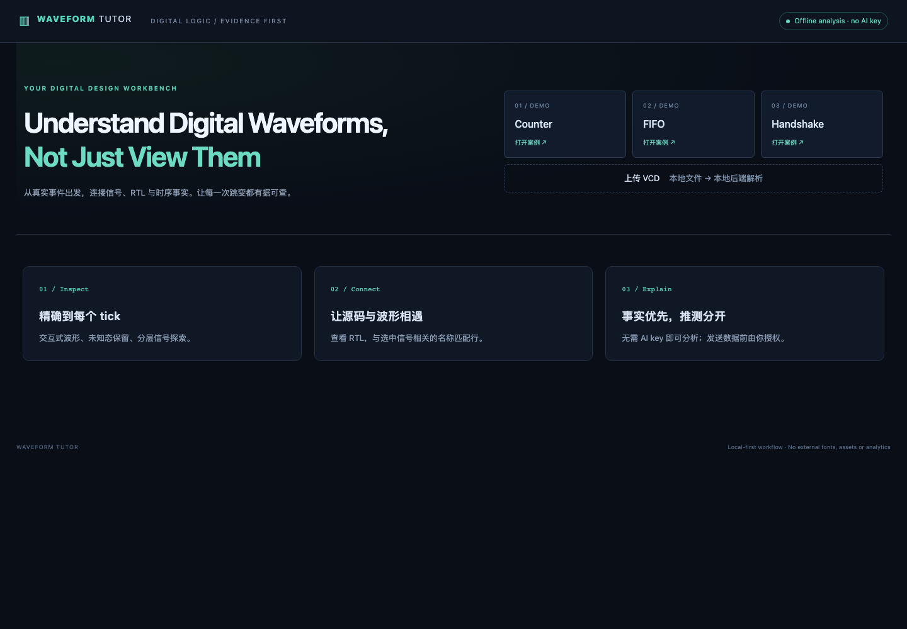
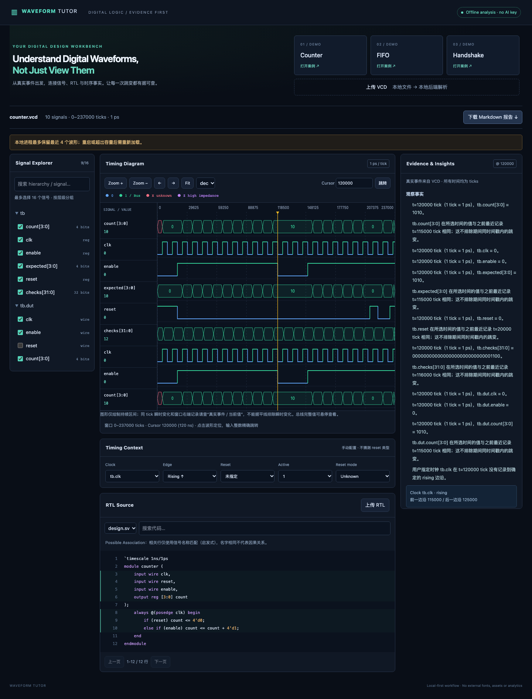

# Waveform Tutor

Understand digital waveforms, not just view them.

[简体中文](README.zh-CN.md) · [Architecture](docs/architecture.md) · [API](docs/api.md) · [Development](docs/development.md) · [Limitations](docs/limitations.md)

## Overview

Waveform Tutor is a local-first learning workbench for undergraduate digital logic and RTL courses. Load a digital VCD trace, inspect recorded events, relate signal names to RTL lines, and distinguish observable facts from possible explanations. The UI is primarily Chinese, with English technical labels.

This is an educational MVP, not a simulator, a full HDL debugger, or a formal verification tool. Core analysis works without an AI account or network connection after dependencies have been installed.

## Motivation

A waveform shows what was recorded, but a student still needs to ask: What value is present at this tick? Was there a definite clock edge? Is reset behavior configured or inferred? Which source lines mention this signal? Waveform Tutor makes these questions explicit without presenting a plausible explanation as proven causality.

## Features

- Load a local `.vcd` file or open Counter, FIFO, and Handshake demos with bundled RTL and pre-generated traces.
- Browse hierarchical signals and select up to 16; zoom, pan, fit, click the waveform, or jump to an exact integer tick.
- View binary, hexadecimal, or unsigned decimal values; preserve X/Z values instead of converting them to numbers.
- Inspect current values, strictly earlier/later records, bounded window events, and explicit truncation warnings.
- Configure clock, edge, reset polarity, and reset mode manually; do not guess synchronous versus asynchronous reset from a trace.
- Upload `.v`/`.sv` source as text and inspect name-matched lines, not semantic HDL bindings.
- Download an offline Markdown report of facts, window events, and limitations.
- Optionally request an AI explanation with explicit data-sharing consent and separate RTL consent.

## Screenshots

Actual local application captures, not mockups:





## Quick start: get the project and run locally

This is a local browser application, not an already hosted website. On GitHub, choose **Code → Download ZIP** and extract it, or clone the repository. Replace YOUR_USERNAME below with the repository owner's actual GitHub name. For a ZIP, open a terminal in the extracted project instead.

```sh
git clone https://github.com/YOUR_USERNAME/waveform_tutor.git
cd waveform_tutor
```

Install Python **3.11+**, Node.js **22.12+**, and npm. On macOS/Linux, install dependencies from the project root; the first installation needs internet access but does not call a model:

```sh
python3 -m venv .venv
.venv/bin/python -m pip install -r backend/requirements.txt
npm --prefix frontend ci
```

In terminal one, start the backend and leave it running:

```sh
.venv/bin/python -m uvicorn backend.app.main:app --host 127.0.0.1 --port 8000 --limit-concurrency 16
```

**Open a second terminal window**, enter the same project folder, and start the frontend. Do not type these commands into the terminal occupied by Uvicorn.

```sh
cd /your/actual/path/waveform_tutor
npm --prefix frontend run dev
```

Open **http://127.0.0.1:5173**, not port 8000. A 404 at `http://127.0.0.1:8000/` is expected: that process provides API routes, not the web page. Vite proxies `/api` to port 8000. Keep both terminals running; use Ctrl+C in each to stop. After backend code changes, restart the backend and refresh the page. Stop your previous process before starting another on the same port.

On Windows PowerShell, use the following installation/backend commands. Windows compatibility has not been fully verified.

```powershell
py -3 -m venv .venv
.\.venv\Scripts\python.exe -m pip install -r backend\requirements.txt
npm --prefix frontend ci
.\.venv\Scripts\python.exe -m uvicorn backend.app.main:app --host 127.0.0.1 --port 8000 --limit-concurrency 16
```

Then open a second PowerShell in the project root, run `npm --prefix frontend run dev`, and open port 5173. Recreate dependencies on each computer; do not copy another machine's virtual environment or node_modules. Bundled traces do not require Icarus Verilog.

## Configure a model, upload and analyze

At the top of the page, open **模型配置** (Model settings). API URL and API Key are required. Model ID and API format are editable; the initial model/format are `gpt-5.6-sol` and Responses. For 4router, use `https://4router.net/v1`. For another provider, enter its actual API model ID, not a display label. A full `/responses` or `/chat/completions` URL is also accepted and determines the protocol.

Choose **保存模型配置** (Save model settings) and read the success/error message. Saving makes no model request and does not prove the key, balance or model is valid. The password input clears after submission; the backend never returns the saved key. Re-enter the key when changing settings. **清除配置并关闭 AI** removes the browser-managed key and disables AI without affecting offline analysis. Settings cannot change during an active AI request.

Upload a digital `.vcd` file, at most 8 MiB, or open Counter, FIFO or Handshake. Files are parsed by the local backend; choose signals and a cursor position to see waveforms and deterministic evidence. This is not a general PDF/CSV file analyzer. Optional `.v`/`.sv` files are viewed and name-matched, never executed.

In **AI Explanation**, enter a question, explicitly consent to sharing the selected context, and choose **生成解释** (Generate explanation). The configured provider receives only the bounded context and the result appears in that panel. RTL snippets need separate consent. Uploading alone never invokes the model. Offline analysis and Markdown export remain available without AI or if a provider fails.

## GitHub and online availability

**Uploading a repository is not deploying a website.** No public hosted version is provided. GitHub Pages cannot run this Python/FastAPI backend, so publishing source code or frontend/dist alone does not provide the complete application. There is currently no verified public-online setup procedure to offer.

A future hosted version would need frontend and Python hosting, HTTPS, authentication, per-user settings and credential isolation, quotas and upload controls. The current single-user local settings endpoint must not be exposed directly on the internet. For now, other users follow the local steps above and operate the app in their browser.

To publish the source yourself, create an empty GitHub repository and replace YOUR_USERNAME below. These are optional owner-operated commands, not actions performed by this task:

```sh
git init
git add .gitignore .env.example AGENTS.md LICENSE README.md README.zh-CN.md pyproject.toml backend frontend examples scripts docs .github
git commit -m "Prepare Waveform Tutor educational MVP"
git branch -M main
git remote add origin https://github.com/YOUR_USERNAME/waveform_tutor.git
git push -u origin main
```

If Git/remotes already exist, use the existing history rather than repeating initialization or adding origin. `.gitignore` excludes `.env*` except the empty template, `.waveform-tutor/`, virtual environments, node_modules and generated output. Do not force-add them. Do not drag the entire local folder into GitHub's web uploader: it does not apply your local ignore rules and could upload secrets. Adding ignore rules does not remove a secret already committed in history.

## Demo walkthrough

1. Open **Counter**. Select `tb.clk`, `tb.reset`, `tb.enable`, and `tb.count[3:0]` (use the names shown by the explorer).
2. Set Clock to `tb.clk`, Edge to Rising, Reset to `tb.reset`, Active to `1`, and Reset mode to Synchronous. That mode comes from the example RTL, not automatic inference.
3. Enter **120000** in Cursor and choose **跳转**. The bundled trace has a 1 ps tick, so this is **120 ns**, not 120000 ns. `enable` is `0`; `count` is binary `1010` (decimal 10).
4. Inspect 125000, 135000, and 145000 ticks. The count remains 10 at these clock edges. Compare the event list and related RTL before explaining why.
5. Download the Markdown report. No AI is needed, and this report does not include generated AI prose.

Other useful checkpoints:

| Demo | Recorded behavior to inspect |
| --- | --- |
| Counter | Count wraps from 15 to 0 at 205 ns; reset asserted at 232 ns clears count at the 235 ns rising edge. |
| FIFO | At 55 ns, count reaches 4 and `full=1`; the 65 ns write is rejected. Full/empty acceptance rules are specific to this example. |
| Handshake | Transfers occur at 55, 95, and 105 ns. Use pre-edge valid/ready and the testbench assertions: the value displayed at the edge can already be the post-edge value. |

Each `examples/<name>/lesson.json` contains Chinese questions and expected observations. The UI loads the trace and source files; it is not a lesson-runner interface. See [development](docs/development.md) to regenerate all three traces using the fixed, trusted example script.

## Architecture

```text
React + TypeScript UI (Vite, localhost:5173)
    | /api via development proxy
    v
FastAPI (127.0.0.1:8000)
    |-- PyVCD parser -> bounded, in-memory traces
    |-- deterministic analyzer -> facts / events / Markdown
    |-- RTL text -> name-only source references
    `-- optional AI adapter -> configured provider /chat/completions or /responses
                               (explicit consent required)
```

At most four traces are retained in backend process memory. Restarting the backend or loading beyond this capacity invalidates old IDs. Uploaded files are not persisted as project files. Use one backend process; this is not a persistent, multi-user project service. [Architecture details](docs/architecture.md).

## Optional AI

New users can configure AI through the page without exporting keys. The typed key exists transiently in the form and is sent to the local backend; it is never returned by configuration endpoints, saved to browser storage, or embedded in the frontend build. The backend saves settings in `.waveform-tutor/ai-config.json`, a Git-ignored **plaintext local file**, not an encrypted vault. On POSIX, new files are atomically replaced from an owner-only temporary file. Do not share this directory or use the local single-user settings endpoint as a public service.

Saved page settings take precedence over environment variables. Clearing settings removes the browser-managed key and writes a disabled marker, preventing surprise fallback to an old environment key. Changes apply immediately and persist across backend restarts. To restore environment-only configuration, stop the backend and remove `.waveform-tutor/ai-config.json` yourself. Clearing page settings does not remove old `.env*` files or shell variables.

Advanced users can still supply `AI_BASE_URL`, `AI_API_KEY`, and `AI_MODEL` to the backend process. **The app does not automatically load `.env`**; [.env.example](.env.example) remains a template for this alternative. Non-secret environment settings:

```sh
export AI_BASE_URL='<provider base URL ending /v1>'
export AI_MODEL='<provider model identifier>'
export AI_API_FORMAT=chat_completions
export AI_TIMEOUT_SECONDS=30
export AI_MAX_OUTPUT_TOKENS=2048
```

Supply `AI_API_KEY` through your own secure shell/environment or secret manager, then restart the backend. Do not paste keys into chat, source code, the frontend, screenshots, or a command that stores the key in shell history. Interactive secret-reading syntax differs between shells; use your shell's documented mechanism. Do not use frontend `VITE_*` variables for secrets.

The adapter uses HTTPX, not an official provider SDK, and has two explicit **non-streaming** wire formats. `AI_API_FORMAT=chat_completions` (the unchanged default) appends `/chat/completions`, sends messages/max_tokens and expects `choices[0].message.content`. `AI_API_FORMAT=responses` appends `/responses`, sends instructions/input/max_output_tokens with `store=false`, and extracts text from completed assistant messages in the REST `output` array. Reasoning is not displayed; tool calls, refusals, incomplete or malformed responses are rejected. Both paths request JSON text and run the same application schema/reference checks; neither assumes provider JSON-mode support. There is no automatic endpoint fallback, which could otherwise create unapproved extra calls. `store=false` requests no API response storage, but does not guarantee that a third-party service retains no logs. Compatibility and model availability still require real testing; no provider/model is endorsed.

Data is sent only after an explicit explanation request with consent: the question and deterministic analysis context, including selected signal names, values, up to 128 window records per signal, strictly earlier/later neighboring records, and manually configured clock/reset names and settings. The analysis window is centered on the cursor and can differ from the visible viewport; neighboring records may lie outside it. The UI shows the actual analysis window. Matched RTL snippets (at most 32 name matches, up to 300 characters per line) are included only with separate RTL consent; this is not a full-project upload. These snippets can omit control flow or sampling rules. Review sensitive signal names and questions before sharing them.

Page-managed configurations use one attempt without automatic retries; environment-only setups can still set AI_MAX_ATTEMPTS. An optional positive `AI_REQUEST_BUDGET` caps HTTP attempts in the current provider instance. If you previously set it to 2, manual use stops after that limit. For normal use without this cap, unset it before starting the backend (`unset AI_REQUEST_BUDGET`, or PowerShell `Remove-Item Env:AI_REQUEST_BUDGET -ErrorAction SilentlyContinue`). Without a cap, each explicit explanation can incur charges. Restarting or saving settings creates a new instance and resets counters; this is not a persistent billing ledger. Set spending limits with the provider. Cancellation does not retract data or guarantee the provider stops billing.

One real minimal connectivity request succeeded with third-party 4router/gpt-5.6-sol. **Full waveform quality assessment and real-provider browser E2E remain incomplete.** The newly added page configuration/persistence feature has not been tested or built in this closing pass, at the owner's request; previous passing results do not cover it. A pure offline preparation command is available: `.venv/bin/python scripts/prepare_ai_evaluation.py --output <new-evidence.json>`. It preserves the original 18 content questions plus N1 Mock-only fault contract and adds explicit A1 asynchronous-reset coverage; answers and scores stay empty until real execution. It never reads provider configuration or calls a model. See the [current AI acceptance report](docs/qa/real-ai-acceptance-report.md).

Responses undergo structural validation; signal/code references are checked against provided allowlists, and `observed_facts` is overwritten with backend-generated facts. **Free-text explanations can still hallucinate.** A valid response is neither a simulation result nor formal verification. Provider failures do not remove offline functionality. See [API](docs/api.md) and [limitations](docs/limitations.md).

## Supported formats and bounds

- Digital VCD scalar/vector values (`0`, `1`, `x`, `z`), hierarchical names, aliases, and declared timescales from seconds to femtoseconds.
- UTF-8 `.v`/`.sv` text for viewing and name matching only; uploaded RTL is never compiled or executed.
- VCD: 8 MiB, 512 signal declarations, 256 bits per signal, 100,000 alias-expanded events, 32 scope levels, and timestamps at most `2^53 - 1` ticks.
- RTL: 128 KiB per file, at most eight files per trace, including bundled demo sources.
- UI: 16 visible signals, at most 2,000 rendered segments per signal; analysis: at most 128 window events per signal, with truncation indicated.
- No FST/FSDB, real/string/event signals, or full SystemVerilog AST support.

## Testing

Run from the repository root after installing dependencies:

```sh
.venv/bin/python -m pytest -q
.venv/bin/ruff check backend scripts
.venv/bin/ruff format --check backend scripts
npm --prefix frontend run build
npm --prefix frontend run typecheck
npm --prefix frontend run test
frontend/node_modules/.bin/playwright install chromium
npm --prefix frontend run test:e2e
```

Playwright starts both FastAPI and Vite automatically using the root `.venv`; outside CI it can reuse already-running local servers. Run without AI environment variables for the offline integration assertions. Chromium installation may require a network connection.

Local validation has included backend pytest tests, frontend `node:test` tests, real-API browser tests, mocked browser tests, and regeneration of all three demo traces with passing assertions. Mocked AI tests are not evidence of live-provider reliability. Test counts are intentionally not fixed here. Remote GitHub CI has not been verified; no passing-check claim is made. See [development](docs/development.md) for scope and troubleshooting.

The 2026-11-16 release-candidate results remain in the [QA report](docs/qa/functional-test-report.md), [independent correctness report](docs/qa/correctness-report.md), [performance measurements](docs/qa/performance-report.md), and [release checklist](docs/qa/release-checklist.md). The [2026-11-17 AI preflight](docs/qa/real-ai-acceptance-report.md) records fresh Linux ARM64 / Python 3.12.15 / Node 22.23.4 regression results. npm audit and a PyPI advisory audit of all 26 pinned Python requirements completed with no reported known vulnerabilities in that run; this is not a security guarantee or a Git-history scan. Real connectivity has succeeded once, but waveform quality and real-provider browser acceptance remain incomplete. The new page-settings increment was not run-verified; remote CI has not run.

## Limitations

Files containing `$dumpoff` are rejected rather than treating unrecorded intervals as known values. Identifier lengths and aggregate names are bounded. RTL is paged at 200 lines, with full-file search retaining original line numbers.

VCD records do not prove RTL execution order, delta cycles, NBA scheduling, or causality. The cursor uses the last recorded value at a timestamp; only strict `0→1` and `1→0` transitions count as definite edges. Unknowns remain binary, and decimal display is unsigned. Source matches can include comments and unrelated same-name variables. Truncated visualization is not evidence that nothing happened. There is no persistent project storage, arbitrary RTL simulation, or public-service security model. Read the [full limitations](docs/limitations.md) before interpreting results.

## Roadmap

Possible future work, **not implemented promises**:

- Semantic HDL source mapping with explicit provenance.
- Larger-trace processing and clearer navigation around dense event windows.
- More teaching examples and accessibility/usability evaluation with students.
- Carefully designed project persistence and additional trace formats.

## Contributing

Start with [development](docs/development.md) and [AGENTS.md](AGENTS.md). Keep changes small, add tests for parser/timing semantics, and preserve the distinction between evidence and inference. Never execute uploaded source or commit credentials. Report bugs with a minimal non-sensitive trace, selected signals, cursor tick, expected/actual results, and relevant environment versions. Do not claim test results you did not observe.

## License

Project code is released under the [MIT License](LICENSE), copyright © 2026 Waveform Tutor contributors. Dependencies retain their own licenses; see [dependency notes](docs/dependencies.md). Icarus Verilog is an optional external development tool, not bundled or linked into this application. These notes are not a legal compatibility guarantee.
