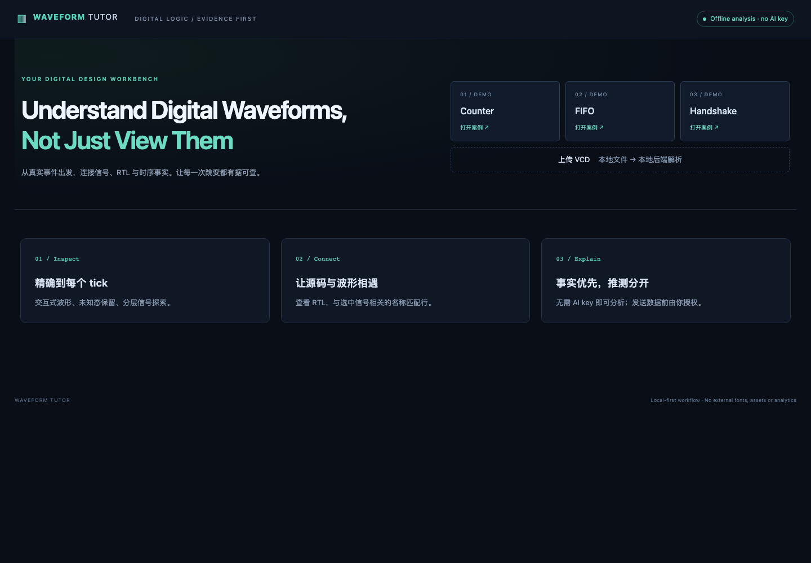
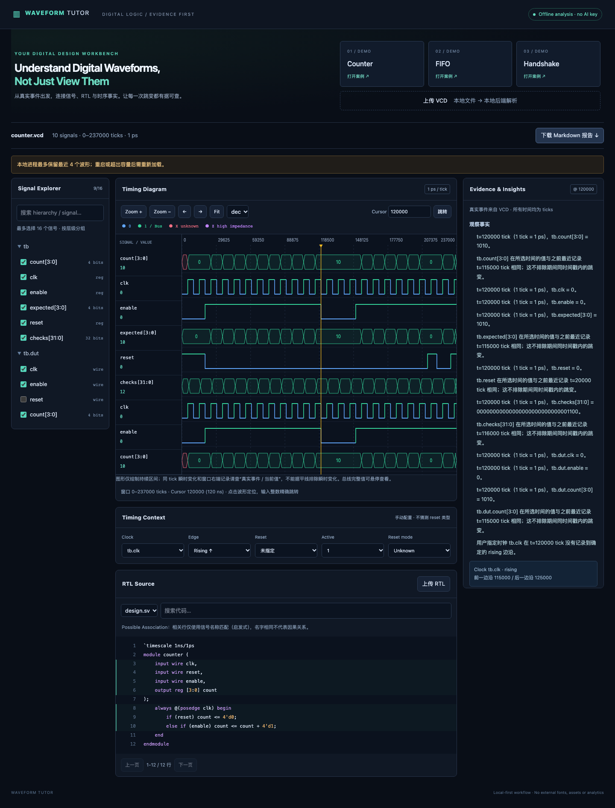

# Waveform Tutor

不只看波形，还要理解哪些结论有证据。

[English（主文档）](README.md) · [架构](docs/architecture.md) · [API](docs/api.md) · [开发](docs/development.md) · [限制](docs/limitations.md)

## 项目简介与动机

Waveform Tutor 是面向本科数字逻辑、计算机组成和 RTL 课程的本地学习工具。界面以中文说明为主，保留部分英文技术标签。你可以上传数字 VCD、检查真实事件、查看 RTL 中的同名信号行，并区分“观察事实”和“可能解释”。

波形记录了值，却不自动证明“为什么”。本项目让学生先检查时间单位、当前值、确定边沿和复位配置，再提出解释。它是教学 MVP，不是仿真器、完整 HDL 调试器或形式验证工具。

## 已实现功能

- 上传 `.vcd`，或打开自带 Counter、FIFO、Handshake 案例。
- 分层查找信号，最多选择 16 个；缩放、平移、Fit、点击定位、整数 tick 精确跳转。
- 二进制、十六进制和无符号十进制显示；含 X/Z 的总线保留二进制，不伪装成确定数值。
- 查看当前值、严格早于/晚于光标的记录、窗口事件和截断提示。
- 手动配置时钟、边沿、复位有效电平与复位类型，不自动推断同步/异步复位。
- 上传 `.v`/`.sv` 文本，查看名称匹配行；不会编译或执行上传源码。
- 下载确定性分析的 Markdown 报告，无需 AI。
- 可选 AI 解释：先明确同意发送分析上下文，RTL 片段另行授权。

## 实际截图





## 快速开始：从 GitHub 获取并本地运行

这是本地网页应用，当前没有公开在线体验地址。其他用户需要从你的 GitHub 仓库点击 **Code → Download ZIP** 并解压，或克隆仓库。以下 `你的用户名` 是需要替换的占位符；ZIP方式直接在解压后的项目文件夹打开终端即可。

```sh
git clone https://github.com/你的用户名/waveform_tutor.git
cd waveform_tutor
```

安装 Python **3.11+**、Node.js **22.12+** 和 npm。macOS/Linux 下，在项目根目录安装依赖（首次需要联网，不会调用模型）：

```sh
python3 -m venv .venv
.venv/bin/python -m pip install -r backend/requirements.txt
npm --prefix frontend ci
```

终端一启动后端，保持运行：

```sh
.venv/bin/python -m uvicorn backend.app.main:app --host 127.0.0.1 --port 8000 --limit-concurrency 16
```

**另开一个终端窗口**，进入同一个项目根目录，再启动前端。不要把下面命令输入到正在运行 Uvicorn 的终端里。

```sh
cd /你的实际路径/waveform_tutor
npm --prefix frontend run dev
```

打开 **http://127.0.0.1:5173**，不是8000。`http://127.0.0.1:8000/` 返回404是预期行为：8000只提供后端API，网页由5173提供。前端通过Vite代理访问本机后端；两个终端都需保持运行，分别按 `Ctrl+C` 停止。更新后端代码后需停止并重新启动后端，刷新网页。遇到端口占用先停止自己之前启动的进程，不要重复启动。

Windows PowerShell的首次安装命令如下；其余页面操作相同。Windows完整兼容性未验收。

```powershell
py -3 -m venv .venv
.\.venv\Scripts\python.exe -m pip install -r backend\requirements.txt
npm --prefix frontend ci
.\.venv\Scripts\python.exe -m uvicorn backend.app.main:app --host 127.0.0.1 --port 8000 --limit-concurrency 16
```

然后另开PowerShell，进入项目根目录，执行 `npm --prefix frontend run dev`，访问5173。Python虚拟环境和node_modules不能从另一台电脑复制，须在本机重新安装。打开自带Demo不需要Icarus Verilog。

## 网页配置、上传与分析

打开网页顶部的“模型配置”。URL和API Key为必填项；还可调整模型ID和接口类型。4router示例为URL `https://4router.net/v1`、模型ID `gpt-5.6-sol`、接口 `Responses`。其他服务商请填写自己的真实model ID；URL也可直接填完整 `/responses` 或 `/chat/completions` 端点，程序按完整端点选择协议。不要把控制台显示名称当作API模型ID。

点击“保存模型配置”，页面会显示保存成功或失败。保存只写入本机，不调用Provider，不代表密钥有效或余额充足。保存成功后Key输入框清空，刷新不会回显旧Key；修改配置需要重新输入Key。点击“清除配置并关闭AI”可移除网页保存的Key并保持离线模式。AI请求处理中不允许更换配置，等待结束或取消后再保存。

接着点击“上传VCD”选择 `.vcd` 文件（最多8MiB），或直接打开Counter/FIFO/Handshake Demo。系统在本机后端解析并显示波形，选择信号、时间点和必要的Clock/Reset设置即可看到确定性事实。这里的“数据文件”指数字VCD，不是任意CSV、PDF或其他格式；可选 `.v`/`.sv` 仅用于源码查看和名称关联。

在右侧“AI Explanation”输入问题，勾选发送上下文的同意框，点击“生成解释”。系统将选中信号和有界分析上下文交给已配置的模型，结果显示在同一区域；失败有提示，可取消等待。RTL片段需另行同意，上传本身不自动外发或调用模型。无AI配置、Provider失败时仍可查看波形、事实和导出离线Markdown报告。

## GitHub 与在线使用

**GitHub存放代码不等于部署了网站。** 当前没有托管好的在线版本，也没有多用户登录或账户隔离。GitHub Pages仅能托管静态文件，不能运行本项目的FastAPI后端；仅上传源码或frontend/dist不能得到完整在线应用。本轮不提供未经实现或验证的公网部署步骤。

如以后要提供公开在线版，需要独立托管前端和Python后端，并补齐HTTPS、登录鉴权、每用户配置/密钥隔离、上传与调用额度限制及持久化方案；现有本机设置接口不能原样公开。当前可用方式就是上面的本地运行，用户仍是在浏览器里操作。

首次上传到自己仓库时，先在GitHub创建空仓库（仓库地址自行替换）。以下是你确认要发布后自行执行的示例，不是本任务已执行的操作：

```sh
git init
git add .gitignore .env.example AGENTS.md LICENSE README.md README.zh-CN.md pyproject.toml backend frontend examples scripts docs .github
git commit -m "Prepare Waveform Tutor educational MVP"
git branch -M main
git remote add origin https://github.com/你的用户名/waveform_tutor.git
git push -u origin main
```

已有Git仓库或远程时不要重复init/add origin，按现有历史提交即可。`.gitignore`排除了 `.env*`（除无密钥模板）、`.waveform-tutor/`、`.venv/`、node_modules与构建缓存；不要使用 `git add -f` 强行加入。**不要把整个本机文件夹拖到GitHub网页上传**：网页上传不替你应用本地.gitignore，可能包含密钥；只提交源码、示例和说明文件。历史秘密泄漏不能靠新加.gitignore消除。

## 五分钟案例

1. 打开 **Counter**，在信号列表选中 `tb.clk`、`tb.reset`、`tb.enable`、`tb.count[3:0]`，以实际列表名称为准。
2. Clock 选择 `tb.clk`；Edge 选择 Rising；Reset 选择 `tb.reset`；Active 为 `1`；Reset mode 选择 Synchronous。这里的同步复位来自示例 RTL，不是波形自动推断。
3. Cursor 输入 **120000**，点击“跳转”。示例每 tick 为 **1 ps**，因此这里是 **120 ns**。观察 `enable=0`、`count=1010`（十进制 10）。
4. 查看 **125000、135000、145000** tick，三个上升沿处 count 均保持 10。结合事件与源码再解释原因。
5. 下载 Markdown 报告，记录事实、窗口事件与限制。报告不包含 AI 生成解释。

其他检查点：FIFO 在 **55 ns** 后 `count=4`、`full=1`，65 ns 写入被拒绝；Handshake 在 **55、95、105 ns** 发生三次传输。握手必须看沿前 valid/ready，沿上的光标值可能已是更新后的值，不能只凭单个光标值恢复仿真调度。

`examples/<name>/lesson.json` 提供中文问题和预期观察；界面目前加载波形与源码，不是自动教学题目播放器。三个案例由固定受信任脚本真实仿真生成，见[开发指南](docs/development.md)。

## 架构与数据生命周期

React + TypeScript/Vite 前端通过本地代理访问 FastAPI。PyVCD 解析器产生内存中的信号事件；确定性分析器返回事实、窗口记录和报告；RTL 关联仅做名称匹配；可选 HTTPX 适配器向配置的 AI 提供商发送解释请求。

后端最多保存最近 **4 个 trace**，重启或超出容量会使旧 ID 失效。上传内容不作为文件持久保存；刷新页面也不会自动恢复工作区。这不是持久项目系统。详细内容见[架构](docs/architecture.md)。

## 可选 AI 配置与隐私

新用户推荐使用上方“模型配置”表单，无需export密钥。网页填写的密钥只在输入/提交时存在于页面内存，通过本机API交给后端，后端**不会回传密钥**；不写入localStorage/sessionStorage，不进入前端构建。网页配置保存在 `.waveform-tutor/ai-config.json`，是Git忽略的本机明文文件，不是加密保险箱。POSIX下新文件由仅所有者可读写的临时文件原子替换；不要分享该目录或在不受信任的公共服务器使用本功能。

配置优先级：网页本地配置优先于后端环境变量；清除操作写入“已关闭”标记，不会偷偷恢复环境里的旧Key。保存后当前进程立即使用新配置，重启后也可读取。要重新使用环境变量方式，可在关闭后端后自行移除 `.waveform-tutor/ai-config.json`。清除只处理网页管理的配置，不删除旧 `.env*` 文件或shell环境。

高级用法仍支持在启动后端的环境中配置 `AI_BASE_URL`、`AI_API_KEY`、`AI_MODEL`。应用**不会自动加载 `.env`**，[.env.example](.env.example)仅为高级环境配置模板。非敏感配置示例：

```sh
export AI_BASE_URL='<provider base URL ending /v1>'
export AI_MODEL='<provider model identifier>'
export AI_API_FORMAT=chat_completions
export AI_TIMEOUT_SECONDS=30
export AI_MAX_OUTPUT_TOKENS=2048
```

请用自己的安全环境管理或秘密管理工具设置 `AI_API_KEY`，再重启后端。不要把 key 贴进聊天、前端、截图、仓库或会留下明文历史的命令。不同 shell 的隐藏输入语法不同，请按所用 shell 文档操作；不要通过前端 `VITE_*` 变量传密钥。

适配器使用 HTTPX，不是官方 SDK，支持两种显式选择的**非流式**请求格式。`AI_API_FORMAT=chat_completions` 保持原默认行为：追加 `/chat/completions`，发送 messages/max_tokens，解析 choices[0].message.content。`AI_API_FORMAT=responses` 追加 `/responses`，发送 instructions/input/max_output_tokens，并设置 store=false；从原始 REST output 数组提取已完成 assistant 消息的 output_text，不展示 reasoning，拒绝工具、拒答、不完整或畸形输出。两条路径都要求 JSON 文本并复用应用结构/引用校验，不假定 JSON mode。不会自动切换端点重试，以免产生未获授权的额外调用。store=false 仅请求关闭 API 响应存储，不保证第三方不保留日志。实际兼容性和模型可用性仍须真实验收。

只有明确点击生成并同意后才发送问题和确定性上下文：选中信号名/当前值、每信号最多 128 条窗口事件、严格早于/晚于光标的相邻记录，以及手动指定的 Clock/Reset 名称与配置。分析窗口以光标为中心，可能不同于可见视口；相邻记录可能位于窗口外。界面显示实际分析窗口。单独授权 RTL 后才附带最多 32 项名称匹配、每行最多 300 字符的片段，而非整个项目；这些片段可能缺少控制条件或采样逻辑。信号名和问题也可能敏感，请先审阅。

网页保存的配置每次只尝试一次，不自动重试；高级环境配置仍支持AI_MAX_ATTEMPTS。可在启动前设置 `AI_REQUEST_BUDGET=2` 等正整数限制当前Provider实例的HTTP尝试；如果曾设置为2，手动体验达到上限就会停止。正常自用不需要该限制时，可在启动前 `unset AI_REQUEST_BUDGET`（PowerShell：`Remove-Item Env:AI_REQUEST_BUDGET -ErrorAction SilentlyContinue`）。默认未设置则没有总次数上限，每次用户点击仍可能产生费用。重启或网页重新保存配置会重建实例并清零计数，这不是持久账本；第三方平台额度限制应在服务商处设置。取消不能撤回已发送数据或保证免于计费。

曾完成一次4router/gpt-5.6-sol真实最小连通性请求；**完整数字质量基准和真实浏览器链路尚未完成**，不能宣称AI全面验收通过。本轮新增网页配置/保存功能按所有者要求只补代码和说明，未执行新的测试、构建或扫描；历史测试结果不覆盖新增功能。纯离线准备命令为 `.venv/bin/python scripts/prepare_ai_evaluation.py --output <新的证据文件.json>`：保留原 18 道模型内容题与 N1 Mock 故障合同，并明确补充 A1 异步复位；答卷和评分在真实执行前保持空值。脚本不读取 Provider 环境配置、不调用模型。见[当前 AI 验收报告](docs/qa/real-ai-acceptance-report.md)。

响应经过结构校验，信号和代码引用受白名单约束，`observed_facts` 被后端确定性事实覆盖。**自由文本仍可能幻觉；不是形式验证或已证实因果。** AI 不可用不影响离线功能。

## 格式与边界

| 项目 | 当前范围 |
| --- | --- |
| 波形 | 数字 VCD，标量/向量 0/1/X/Z、层级、别名、声明的 timescale |
| VCD 限额 | 8 MiB、512 信号、每信号 256 bit、别名展开后 100,000 事件、32 层 scope |
| 时间 | 非负整数 tick，最大 `2^53 - 1` |
| RTL | UTF-8 `.v`/`.sv`；每文件 128 KiB，每 trace 最多 8 文件，含案例自带源码 |
| 展示 | 最多 16 信号，每信号最多绘制 2,000 segments |
| 分析 | 每信号窗口最多返回 128 条事件，截断有提示 |

不支持 FST/FSDB、real/string/event 信号或完整 SystemVerilog AST。同时间戳取最后记录值；只把严格 `0→1`/`1→0` 当作确定边沿，不从 X/Z 过渡推断边沿。VCD 不证明 delta-cycle/NBA 执行顺序或因果，名称匹配可能命中注释和无关同名变量。完整说明见[限制](docs/limitations.md)。

## 测试

从项目根目录执行：

```sh
.venv/bin/python -m pytest -q
.venv/bin/ruff check backend scripts
.venv/bin/ruff format --check backend scripts
npm --prefix frontend run build
npm --prefix frontend run typecheck
npm --prefix frontend run test
frontend/node_modules/.bin/playwright install chromium
npm --prefix frontend run test:e2e
```

Playwright 使用根目录 `.venv` 自动启动 FastAPI 和 Vite；非 CI 时可复用已经运行的本地服务。离线集成断言要求未配置 AI 环境变量；首次安装 Chromium 可能需要联网。

本地验证覆盖后端 pytest、前端 `node:test`、真实 API 浏览器场景、mock 浏览器场景，以及三个案例重新生成时的断言。数量随开发变化，不在此固定。mock AI 测试不代表真实服务可靠性；尚未验证远程 GitHub CI，不能据此声称远程 checks 通过。

2026-11-16 发布候选的历史结果保留于[功能报告](docs/qa/functional-test-report.md)、[独立正确性](docs/qa/correctness-report.md)、[性能测量](docs/qa/performance-report.md)及[发布清单](docs/qa/release-checklist.md)。[2026-11-17 AI 准备验收](docs/qa/real-ai-acceptance-report.md)记录了 Linux ARM64、Python 3.12.15、Node 22.23.4 下的新回归结果；本轮 npm audit 与全部 26 个固定 Python 依赖的 PyPI 已知漏洞查询完成，未报告已知漏洞，不代表无漏洞或已检查 Git 历史。真实AI已有一次最小连通成功，业务质量/浏览器全链路仍未完成；新网页配置增量未运行验证，远程CI未运行。含 `$dumpoff` 的文件明确拒绝；名称有长度/累计预算限制，RTL 每页 200 行，全文搜索保留原行号。

## 后续方向与贡献

后续可探索语义级 HDL 关联、更大波形处理、更多教学例子、学生可用性与无障碍评估，以及经过设计的项目持久化和其他格式。这些是方向，不是已实现功能或交付承诺。

贡献前阅读[开发指南](docs/development.md)与 [AGENTS.md](AGENTS.md)。保持改动小而可验证，补充解析与时序语义测试；不执行用户上传源码，不提交秘密，不编造测试结果。报告问题时附最小脱敏波形、信号、tick、预期/实际结果及环境版本。

## 许可证

项目采用 [MIT](LICENSE)，Copyright (c) 2026 Waveform Tutor contributors。依赖保留各自许可证，见[依赖说明](docs/dependencies.md)。Icarus Verilog 是可选外部开发工具，不随应用打包或链接；这些说明不构成许可证兼容性的法律保证。
